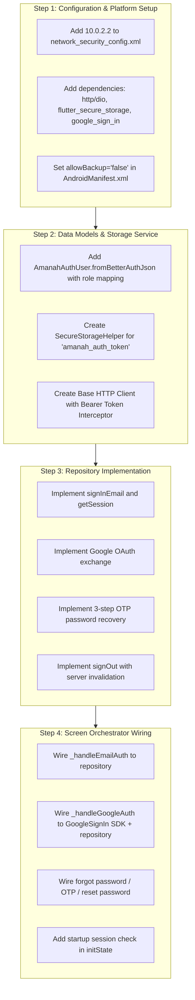

# Frontend Authentication Adjustment Plan: Flutter Mobile to Better Auth Backend

> **Scope:** Minimal, targeted adjustments required to connect the existing Flutter Authentication Module to the verified Better Auth Backend  
> **Auditor:** Senior Flutter Frontend Engineer  
> **Date:** 2026-09-20  
> **Status:** 📋 **Ready for Review (Pre-Implementation Plan)**  
> **Artifact Path:** `docs/frontend/authentication-mobile-adjustment-plan.md`

---

## 1. Guiding Principles
1. **Reuse Before Modification**: Retain all existing UI screens, organisms, form validators, and password requirement components (`SignInContent`, `SignUpContent`, `ForgotPasswordContent`, `OtpVerificationContent`, `ChangePasswordContent`, `PasswordChangedSuccessContent`, `AmanahPasswordRequirements`).
2. **Minimal Surface Area**: Adjust only the data layer, networking, local storage, and role parsing. Do not introduce new architectural layers or refactor unrelated code.
3. **Strict Boundary**: This document defines the adjustment plan only. **No implementation has been performed during this verification phase.**

---

## 2. Minimal Adjustment Matrix

| Gap | Backend Contract Requirement | Current Flutter Behavior | Required Minimal Adjustment | Files Likely Affected | Risk & Mitigation |
| :--- | :--- | :--- | :--- | :--- | :--- |
| **G.1: Mock Data Source** | `POST /api/auth/sign-in/email` with `{ email, password }` returning `{ token, user }`. | Reads static `assets/amanah/auth/auth_credentials.json` with artificial 650ms delay. | Implement `BetterAuthRepository` (or update `AmanahAuthRepository`) to execute HTTP `POST` to backend endpoint using standard HTTP client. | `packages/amanah_healthcare/lib/features/authentication/data/amanah_auth_repository.dart` | **Low**. The existing UI already awaits `authenticate()`. Replacing the internal mock with an HTTP call preserves the presentation signature. |
| **G.2: Missing Session Persistence** | Store session token under key `'amanah_auth_token'` in encrypted storage. | Session is stored in-memory in `_authenticatedUser`; lost on cold restart. | Add `flutter_secure_storage` dependency. Write token upon sign-in/OAuth success; delete upon logout. | `packages/amanah_healthcare/pubspec.yaml` `lib/features/authentication/presentation/screen/auth_bottom_sheet_screen.dart` | **Low**. Standard mobile storage pattern backed by Android Keystore. |
| **G.3: Missing Session Restoration** | `GET /api/auth/get-session` with `Authorization: Bearer <token>` to validate active session on launch. | App always launches into unauthenticated `AuthBottomSheetScreen`. | In `initState()` or splash initialization, check for `'amanah_auth_token'`. If found, call `GET /api/auth/get-session`. If valid, mount `AmanahHomeShell`; otherwise clear token. | `lib/features/authentication/presentation/screen/auth_bottom_sheet_screen.dart` | **Medium**. Network latency during splash. Mitigate with timeout budget (e.g., 5 seconds) and graceful fallback to login. |
| **G.4: Unmapped User Roles & Patient Denial** | Roles: `'staffDoctor'` $\rightarrow$ doctor; `'staffMidwife'`, `'staffWorker'`, `'admin'` $\rightarrow$ staff. `'patient'` must be rejected. | Only recognizes local enum `AmanahUserRole.doctor` and `AmanahUserRole.staff`. | Add factory `AmanahAuthUser.fromBetterAuthJson(Map<String, dynamic> json)` with role parser. If `role == 'patient'`, abort login, invoke `/api/auth/sign-out`, and display error toast. | `lib/features/authentication/domain/amanah_auth_user.dart` `lib/features/authentication/presentation/screen/auth_bottom_sheet_screen.dart` | **Low**. Simple string-to-enum mapping and guard check in repository/controller. |
| **G.5: Simulated Google OAuth** | `POST /api/auth/sign-in/social` with `{ provider: "google", idToken: { token: "<idToken>" } }`. | Simulates 700ms delay with demo toast; no real Google authentication. | Add `google_sign_in` dependency. Configure `GoogleSignIn(serverClientId: WEB_CLIENT_ID)`. Send retrieved `idToken` to backend endpoint. | `packages/amanah_healthcare/pubspec.yaml` `lib/features/authentication/presentation/screen/auth_bottom_sheet_screen.dart` | **Medium**. Requires Web Client ID configured in Google Cloud Console. Handshake guide already documented in `docs/requirements/better-auth-mobile-oauth-guide.md`. |
| **G.6: Disconnected Password Recovery Pipeline** | 3-step OTP: `request-password-reset`, `check-verification-otp`, `reset-password`. | Simulates transitions through `AuthSheetMode` with 650ms delays. | Wire `_handleForgotPassword`, `_handleVerifyOtp`, and `_handleChangePassword` to their respective Better Auth endpoints. | `lib/features/authentication/presentation/screen/auth_bottom_sheet_screen.dart` | **Low**. UI organisms and input controllers already capture exact required payloads. |
| **G.7: Incomplete Logout Lifecycle** | `POST /api/auth/sign-out` with `Authorization: Bearer <token>` to invalidate session on server. | Sets local `_authenticatedUser = null` without notifying backend. | Update `_handleLogout()` to call `POST /api/auth/sign-out`, delete `'amanah_auth_token'`, and call `googleSignIn.signOut()`. | `lib/features/home/presentation/screen/amanah_home_shell.dart` `lib/features/authentication/presentation/screen/auth_bottom_sheet_screen.dart` | **Low**. Ensures server-side session invalidation and cleans client storage. |
| **G.8: Android Emulator Network Security** | Cleartext HTTP allowed for `10.0.2.2:3001` in development. | [`amanah_network_security_config.xml`](file:///D:/amanah-healthcare-mobile/packages/amanah_healthcare/android/app/src/main/res/xml/amanah_network_security_config.xml#L4) only permits `127.0.0.1`. | Add `<domain includeSubdomains="false">10.0.2.2</domain>` to `amanah_network_security_config.xml` so Android emulator can reach host backend. | `android/app/src/main/res/xml/amanah_network_security_config.xml` | **Low**. Standard Android emulator development configuration. |
| **G.9: Android Auto Backup Keystore Conflict** | Recommended `android:allowBackup="false"` to prevent `InvalidKeyException` on encrypted storage. | [`AndroidManifest.xml:25`](file:///D:/amanah-healthcare-mobile/packages/amanah_healthcare/android/app/src/main/AndroidManifest.xml#L25) sets `allowBackup="true"`. | Set `android:allowBackup="false"` or exclude secure storage shared preferences from backup rules per `flutter-better-auth-android` skill. | `android/app/src/main/AndroidManifest.xml` | **Low**. Prevents corrupted session storage on app restore. |

---

## 3. Phased Implementation Roadmap (For Subsequent Phase)

---

## 4. Verification Checklist for Implementation Phase
- [ ] Sign in with valid staff credentials (`dokter@amanah.health`) $\rightarrow$ returns token, navigates to `AmanahHomeShell`.
- [ ] Sign in with invalid credentials $\rightarrow$ returns 401, displays OWASP generic error message, highlights both fields.
- [ ] Sign in with patient credentials $\rightarrow$ rejected, signs out, displays patient restriction error.
- [ ] Cold restart app $\rightarrow$ splash restores session via `GET /api/auth/get-session` without showing login modal.
- [ ] Logout $\rightarrow$ server invalidates session, local storage cleared, returns to login.
- [ ] Password recovery $\rightarrow$ email OTP received in Mailpit, verified, and password reset successfully.
- [ ] Google sign-in $\rightarrow$ native sheet opens, `idToken` exchanged, session established.
