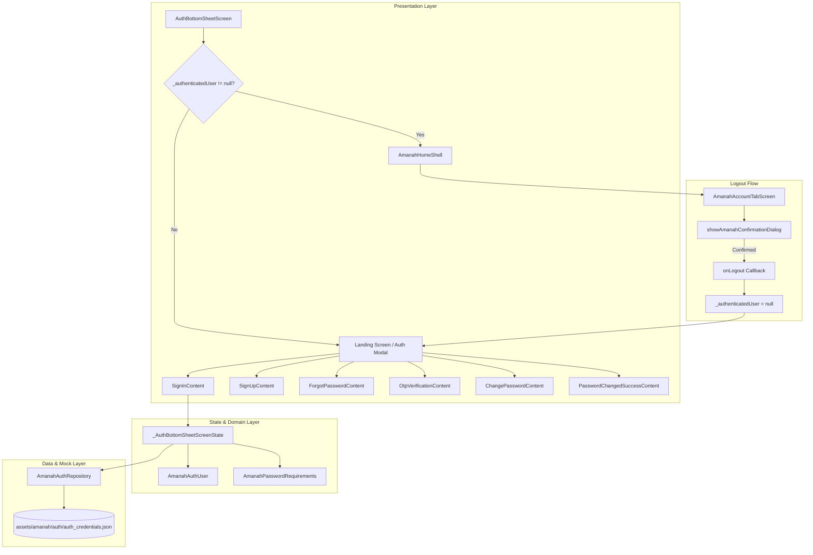
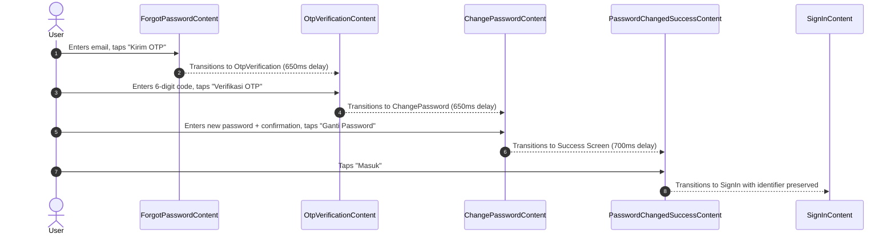
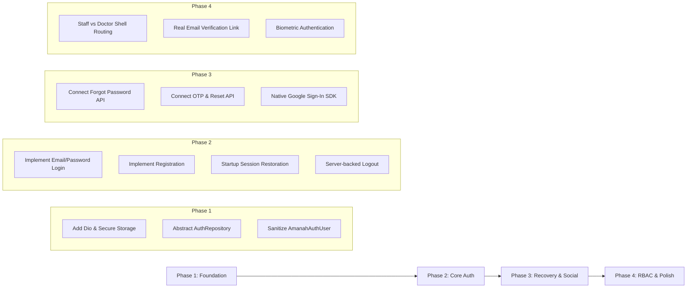

# Authentication Module Requirement Report
**Flutter Frontend Requirement Trace & Backend Delegation Specification**

- **Document Version:** 1.0.0
- **Date:** 2026-09-20
- **Author:** Senior Flutter/Dart Frontend Engineering
- **Target Repository:** `amanah-healthcare-mobile` (`packages/amanah_healthcare`)
- **Target Document Path:** `docs/requirements/authentication-module-report.md`
- **Status:** Complete / Ready for Backend Delegation & Architecture Review

---

## 1. Executive Summary

### 1.1 Overview
This report provides a comprehensive, evidence-based requirement trace of the existing Authentication Module within the `amanah_healthcare` Flutter package. The investigation was conducted strictly from the frontend engineering perspective to document current capabilities, user interaction flows, data models, state management patterns, and backend integration requirements.

### 1.2 Core Findings
1. **Simulated / Mock Current State**: The authentication module currently functions entirely against local mock assets and in-memory state. Credential validation is executed via `AmanahAuthRepository` reading from `assets/amanah/auth/auth_credentials.json` with an artificial delay of 650ms. No real HTTP, REST, or GraphQL network clients (`http`, `dio`) exist in `packages/amanah_healthcare/pubspec.yaml`.
2. **Ephemeral In-Memory Session**: Authentication state is maintained strictly in-memory within `_AuthBottomSheetScreenState._authenticatedUser`. There is no session persistence, token storage (`flutter_secure_storage`), or cache (`shared_preferences`). Consequently, every application cold launch or process termination resets the user to an unauthenticated state.
3. **Dual Identifier (Email or Phone)**: The sign-in interface provides a single input field accepting either an email address or an Indonesian mobile phone number (`+62`, `62`, `08`).
4. **Mocked OAuth and Password Recovery**: Google OAuth, OTP verification (6-digit code), and password reset flows are fully rendered and animated in the UI, but operate purely via simulated timers and dummy state transitions.
5. **Security Deficiencies**: Plaintext passwords are stored in the domain model `AmanahAuthUser.password` and bundled in the client asset `auth_credentials.json`. However, the frontend demonstrates sound security UX in its error-handling paradigm: generic non-revealing error messages are displayed to prevent user enumeration, and both credential fields are highlighted simultaneously.

### 1.3 Purpose of Delegation
This document serves as the formal frontend-to-backend contract delegation specification. It defines the exact endpoints, request/response schemas, session lifecycle requirements, and error payloads required from the backend team (and future Better Auth implementation) to replace the existing mock system without breaking frontend expectations.

---

## 2. Authentication Architecture Current State

### 2.1 High-Level Architecture
The current authentication module follows a feature-driven folder structure within `packages/amanah_healthcare/lib/features/authentication/`.



### 2.2 Component Boundaries & Responsibilities
- **Domain (`lib/features/authentication/domain/`)**:
  - `AmanahAuthUser`: Immutable user model holding `id`, `role` (`AmanahUserRole`), `fullName`, `email`, `phone`, `password`, and `isEmailVerified`.
- **Data (`lib/features/authentication/data/`)**:
  - `AmanahAuthRepository`: Mock repository loading `auth_credentials.json` from the asset bundle via `rootBundle.loadString()`.
- **Presentation State (`lib/features/authentication/presentation/state/`)**:
  - `auth_ui_state.dart`: Defines `AuthSheetMode` enum (`signIn`, `signUp`, `forgotPassword`, `otpVerification`, `changePassword`, `passwordChangedSuccess`).
  - `password_requirements.dart`: Evaluates password compliance (min 8 chars, uppercase, lowercase, number, symbol).
- **Presentation Organisms & Components (`lib/features/authentication/presentation/`)**:
  - `auth_bottom_sheet_screen.dart`: State orchestrator controlling modes, text controllers, loading indicators, and active user session.
  - Organisms: `SignInContent`, `SignUpContent`, `ForgotPasswordContent`, `OtpVerificationContent`, `ChangePasswordContent`, `PasswordChangedSuccessContent`.
  - Reusable Atoms/Molecules: `AuthInputField`, `PasswordInputField`, `OtpCodeField`, `SocialAuthButton`, `PasswordStrengthMeter`, `AuthInlineValidationMessage`, `AuthStatusMessage`.

---

## 3. Authentication Entry Points & Screen Inventory

### 3.1 Entry Point Configuration
The authentication UI is mounted via `AuthBottomSheetScreen`. It acts both as the unauthenticated entry screen and as the parent wrapper that switches to `AmanahHomeShell` upon successful authentication.

```dart
// packages/amanah_healthcare/lib/features/authentication/presentation/screen/auth_bottom_sheet_screen.dart:676-686
if (_authenticatedUser != null) {
  return AmanahHomeShell(
    user: _authenticatedUser,
    onLogout: () {
      setState(() {
        _authenticatedUser = null;
      });
    },
  );
}
```

### 3.2 Screen & Modal Inventory

| Screen / Organism | Mode Enum | Trigger / Route | Input Fields / Controls | Primary Actions | File & Line References |
| :--- | :--- | :--- | :--- | :--- | :--- |
| **Landing Actions** | Initial / Collapsed | App launch | None | "Masuk", "Daftar", "Lupa Password" | `auth_bottom_sheet_screen.dart:584-633` |
| **Sign In** | `AuthSheetMode.signIn` | "Masuk" button or sheet switch | Identifier (Email/Phone), Password | "Masuk", "Masuk dengan Google", "Lupa password?", "Daftar" | `sign_in_content.dart:1-130`<br>`auth_bottom_sheet_screen.dart:345-364` |
| **Sign Up** | `AuthSheetMode.signUp` | "Daftar" button | Full Name, Email, Phone, Password, Confirm Password | "Daftar Sekarang", "Sudah punya akun? Masuk" | `sign_up_content.dart:1-169`<br>`auth_bottom_sheet_screen.dart:366-382` |
| **Forgot Password** | `AuthSheetMode.forgotPassword` | "Lupa password?" link | Email | "Kirim OTP", "Kembali ke Masuk" | `forgot_password_content.dart:1-61`<br>`auth_bottom_sheet_screen.dart:384-398` |
| **OTP Verification** | `AuthSheetMode.otpVerification` | Successful OTP request | 6-digit OTP code (`OtpCodeField`) | "Verifikasi OTP", Resend OTP timer (`00:43`) | `otp_verification_content.dart:1-84`<br>`auth_bottom_sheet_screen.dart:400-417` |
| **Change Password** | `AuthSheetMode.changePassword` | Successful OTP verification | New Password, Confirm Password | "Ganti Password", Strength meter | `change_password_content.dart:1-87`<br>`auth_bottom_sheet_screen.dart:419-434` |
| **Password Changed Success** | `AuthSheetMode.passwordChangedSuccess` | Successful password update | None (Celebration Confetti & Checkmark) | "Masuk" (transitions to `AuthSheetMode.signIn`) | `password_changed_success_content.dart:1-355`<br>`auth_bottom_sheet_screen.dart:436-444` |

---

## 4. Credential-Based Authentication Flow (Email/Password & Phone/Password)

### 4.1 Input Specification
The sign-in form (`SignInContent`) utilizes a combined identifier input:
- **Identifier (`_identifierController`)**:
  - Accepted Types: Email or Indonesian Mobile Phone Number.
  - Validation Logic (`_validateIdentifier`, `auth_bottom_sheet_screen.dart:170-184`):
    - Required: Cannot be empty (`"Email atau nomor handphone wajib diisi."`).
    - Email Regex: `^[^@\s]+@[^@\s]+\.[^@\s]+$`
    - Phone Regex: `^(?:\+62|62|0)8[1-9][0-9]{6,10}$`
    - Phone Minimum Length: At least 8 digits if numeric characters are provided.
    - Rejection Message: `"Gunakan email valid atau nomor HP Indonesia."`
- **Password (`_passwordController`)**:
  - Validation Logic (`_validatePassword`, `auth_bottom_sheet_screen.dart:186-194`):
    - Required: Cannot be empty (`"Password wajib diisi."`).
    - Minimum Length: At least 6 characters (`"Password minimal 6 karakter."`).

### 4.2 Submission and Execution Trace
1. User taps "Masuk" or triggers `TextInputAction.done` (`sign_in_content.dart:37, 68`).
2. `_handleEmailAuth()` is invoked (`auth_bottom_sheet_screen.dart:212-243`):
   - Validates form via `_formKey.currentState!.validate()`.
   - Sets `_loadingProvider = AuthProviderType.email`.
   - Clears existing credential error (`_hasCredentialError = false`).
   - Calls `_authRepository.authenticate(identifier, password)`.
3. `AmanahAuthRepository.authenticate()` (`amanah_auth_repository.dart:15-39`):
   - Simulates 650ms latency via `Future<void>.delayed(const Duration(milliseconds: 650))`.
   - Loads `assets/amanah/auth/auth_credentials.json`.
   - Matches candidate where `(user.email == identifier || user.phone == identifier) && user.password == password`.
   - Returns matched `AmanahAuthUser` or `null`.
4. Response Handling:
   - **Failure (`user == null`)**:
     - Sets `_hasCredentialError = true`.
     - Sets `_credentialErrorMessage = 'Email atau password yang Anda masukkan salah. Silakan periksa kembali.'`.
     - Sets `_loadingProvider = null`.
     - Fields retain entered text so user can correct mistakes.
     - Any edit in either field triggers `onCredentialChanged: _onCredentialChanged`, which immediately clears `_hasCredentialError` (`auth_bottom_sheet_screen.dart:164-168`, `sign_in_content.dart:23-28`).
   - **Success (`user != null`)**:
     - Sets `_authenticatedUser = user`.
     - Sets `_loadingProvider = null`.
     - Triggers rebuild mounting `AmanahHomeShell(user: user)`.

---

## 5. Social Authentication & Third-Party OAuth Traces

### 5.1 Component & Provider Analysis
- **Supported Provider**: Google (`AuthProviderType.google`).
- **UI Component**: `SocialAuthButton` (`social_auth_button.dart:8-52`).
  - Uses `AmanahButton.ghost` with `google_logo.svg` (`assets/amanah/auth/google_logo.svg`).
  - Label: `"Masuk dengan Google"`.

### 5.2 Invocation & Current Behavior
- Triggered via `onGoogleAuth: _handleGoogleAuth` (`auth_bottom_sheet_screen.dart:245-256`).
- Implementation:
  ```dart
  // packages/amanah_healthcare/lib/features/authentication/presentation/screen/auth_bottom_sheet_screen.dart:245-256
  Future<void> _handleGoogleAuth() async {
    setState(() {
      _loadingProvider = AuthProviderType.google;
    });
    await Future<void>.delayed(const Duration(milliseconds: 700));
    if (!mounted) return;
    setState(() {
      _loadingProvider = null;
    });
    _showStatus('Demo autentikasi Google berhasil. Integrasi backend belum diaktifkan.');
  }
  ```
- **Backend Dependency Gaps**:
  - No native Google Sign-In SDK (`google_sign_in`) installed.
  - No OAuth redirect schema or deep link handling registered.
  - No OAuth token exchange endpoint or callback handler.

---

## 6. Multi-Factor Authentication (MFA) & OTP Verification Flows

### 6.1 OTP Flow Structure
- **Screen**: `OtpVerificationContent` (`otp_verification_content.dart:8-84`).
- **Input Control**: `OtpCodeField` holding 6 `TextEditingController` instances.
- **Verification Rule**: Button enabled only when all 6 controllers contain exactly 1 character (`_complete`, `otp_verification_content.dart:29-33`).
- **Resend Countdown UI**: Hardcoded text `"Kirim ulang kode dalam 00:43"` (`otp_verification_content.dart:57-66`). No active timer or resend API trigger exists.

### 6.2 Execution Trace
1. In `ForgotPasswordContent`, user submits email (`_handleForgotPassword`, `auth_bottom_sheet_screen.dart:272-288`).
2. After 650ms delay, mode switches to `AuthSheetMode.otpVerification`.
3. In `OtpVerificationContent`, user enters 6 digits and taps "Verifikasi OTP" (`_handleVerifyOtp`, `auth_bottom_sheet_screen.dart:290-307`).
4. After 650ms delay, mode switches to `AuthSheetMode.changePassword`.
5. **Backend Dependency Gaps**:
   - No OTP generation, dispatch (SMS/Email/WhatsApp), or verification endpoints exist.
   - No verification transaction token or signed challenge is propagated between OTP verification and password change.

---

## 7. Password Management & Recovery Lifecycle

### 7.1 Recovery Progression
The recovery flow traverses four explicit states:
`AuthSheetMode.forgotPassword` $\rightarrow$ `AuthSheetMode.otpVerification` $\rightarrow$ `AuthSheetMode.changePassword` $\rightarrow$ `AuthSheetMode.passwordChangedSuccess` $\rightarrow$ `AuthSheetMode.signIn`.



### 7.2 Password Complexity & Validation Rules
- **Component**: `PasswordStrengthMeter` (`password_strength_meter.dart`) driven by `AmanahPasswordRequirements` (`password_requirements.dart:1-88`).
- **Requirements Evaluated**:
  1. Minimum 8 characters (`value.length >= 8`).
  2. Uppercase and lowercase letters (`RegExp(r'[A-Z]').hasMatch(value) && RegExp(r'[a-z]').hasMatch(value)`).
  3. Numbers (`RegExp(r'[0-9]').hasMatch(value)`).
  4. Symbols / Special characters (`RegExp(r'[!@#$%^&*(),.?":{}|<>]').hasMatch(value)`).
- **Match Validation**: `confirmPassword` must match `passwordController.text` (`change_password_content.dart:56-65`).

---

## 8. Session Management & Persistence Analysis

### 8.1 State Storage Mechanism
- Authentication session is purely **ephemeral and in-memory**:
  - Held in private variable `AmanahAuthUser? _authenticatedUser` inside `_AuthBottomSheetScreenState` (`auth_bottom_sheet_screen.dart:45`).
  - No persistent disk storage: Neither `flutter_secure_storage`, `shared_preferences`, `sqflite`, nor `hive` is used for authentication credentials or tokens.

### 8.2 App Lifecycle & Process Termination
- **Hot Reload**: In-memory state is preserved.
- **Cold Boot / Process Restart**: State is lost. The application always starts with `_authenticatedUser = null`, displaying `AuthBottomSheetScreen` in unauthenticated mode.
- **Backgrounding / Resume**: State is maintained as long as the OS does not terminate the app process.

---

## 9. Token Lifecycle, Refresh Mechanisms & Expiry Handling

### 9.1 Current Token Architecture
- **Access Tokens**: **None**. No JWT, Bearer token, or opaque session token exists in the codebase.
- **Refresh Tokens**: **None**. No token rotation or refresh endpoint exists.
- **Session Cookies**: **None**. No HTTP client cookie jar is configured.
- **Expiry Handling**: **None**. No expiration timestamps, periodic heartbeat, or 401 HTTP interceptors are implemented.

---

## 10. User Identity, Profile & Role Data Models

### 10.1 Domain Model: `AmanahAuthUser`
Located at `packages/amanah_healthcare/lib/features/authentication/domain/amanah_auth_user.dart`:

```dart
class AmanahAuthUser {
  const AmanahAuthUser({
    required this.id,
    required this.role,
    required this.fullName,
    required this.email,
    required this.phone,
    required this.password,
    this.isEmailVerified = false,
  });

  final String id;
  final AmanahUserRole role;
  final String fullName;
  final String email;
  final String phone;
  final String password; // SECURITY DEFICIENCY: Cleartext password in memory
  final bool isEmailVerified;

  bool get isDoctor => role == AmanahUserRole.doctor;
  bool get isStaff => role == AmanahUserRole.staff;

  String get displayRole => switch (role) {
    AmanahUserRole.doctor => 'Dokter Spesialis',
    AmanahUserRole.staff => 'Staf Medis',
  };
}

enum AmanahUserRole { doctor, staff }
```

### 10.2 Profile Integration in `AmanahAccountTabScreen`
In `amanah_account_tab_screen.dart:37-113`:
- Uses `user.fullName` as the doctor's name.
- Fallback email: `user.email.isNotEmpty ? user.email : 'rayhan.pratama@rsamanah.co.id'`.
- Fallback phone: `'+62 812-3456-7890'`.
- Verification badge: `_isEmailVerified` initialized from `widget.user.isEmailVerified`.
  - Supports dummy toggle via long-press on `_WingedMailBanner` (`amanah_account_tab_screen.dart:81-99`).

---

## 11. Authorization, Role-Based Access Control (RBAC) & Route Guards

### 11.1 Current Role Definitions
- Roles are limited to `AmanahUserRole.doctor` and `AmanahUserRole.staff`.
- In mock credentials (`auth_credentials.json`), two users exist:
  1. `doctor-001`: `role = doctor`, `dokter@amanah.health`
  2. `staff-001`: `role = staff`, `staff@amanah.health`

### 11.2 Route Guarding & Navigation Gating
- Currently, there are **no route guards or middleware** implemented in the Flutter Navigator.
- The UI gating is performed entirely by conditional rendering in `AuthBottomSheetScreen.build()`:
  - If `_authenticatedUser != null` $\rightarrow$ renders `AmanahHomeShell`.
  - If `_authenticatedUser == null` $\rightarrow$ renders `Scaffold` containing the bottom sheet modal.
- Note: `AmanahHomeShell` is currently hardcoded for doctor workflows (schedule stack, clinic analytics, doctor ID card), even if signed in as staff.

---

## 12. State Management & Authentication Reactivity

### 12.1 State Paradigm
- The authentication module uses standard Flutter `StatefulWidget` and `setState()`.
- No state management library (Bloc, Riverpod, Provider, MobX) is utilized within `lib/features/authentication/`.
- Other modules in the app (`schedule`, `permission`, `home`) utilize singleton `ChangeNotifier` stores (e.g., `AmanahScheduleStore.instance`, `AmanahPermissionStore.instance`), but authentication remains isolated inside `_AuthBottomSheetScreenState`.

---

## 13. Network Layer, Interceptors & Transport Security

### 13.1 HTTP Client Status
- **Client**: No network client (`http`, `dio`, `chopper`) is present in `packages/amanah_healthcare`.
- **Data Source**: `rootBundle.loadString('assets/amanah/auth/auth_credentials.json')` via `AmanahAuthRepository` (`amanah_auth_repository.dart:18-20`).
- **SSL / TLS Pinning**: Not implemented.
- **Network Resilience**: No offline retry, timeout configuration, or connection connectivity monitoring exists.

---

## 14. Error Handling, Validation Rules & Security Messaging

### 14.1 Security-Conscious Error Feedback
The sign-in flow adheres to OWASP authentication error recommendations to prevent user enumeration:
1. **Generic Credential Error**:
   - Message: `"Email atau password yang Anda masukkan salah. Silakan periksa kembali."`
   - Does NOT disclose whether the email/phone exists or if the password was incorrect.
2. **Simultaneous Field Highlighting**:
   - Both identifier and password fields are highlighted with error borders simultaneously (`hasError: hasCredentialError`, `sign_in_content.dart:45, 62`).
3. **Automated Error Dismissal**:
   - Typing any character into either field calls `onCredentialChanged`, immediately removing the error state (`sign_in_content.dart:23-28`).
4. **Verified via Unit/Widget Test**:
   - Formally tested and asserted in `test/features/authentication/auth_sign_in_content_test.dart:51-118`.

---

## 15. Biometric Authentication & Secure Hardware Enclave Assessment

### 15.1 Assessment
- **Status**: **Not Implemented**.
- No biometric package (`local_auth`) is configured.
- In `AmanahAccountTabScreen`, a menu item titled `"Keamanan akun & PIN"` with badge `"PIN Aktif"` is displayed (`amanah_account_tab_screen.dart:1541-1546`), but routes to a placeholder settings screen without hardware biometric integration.

---

## 16. Account Registration & Onboarding Lifecycle

### 16.1 Registration Flow
- **Organism**: `SignUpContent` (`sign_up_content.dart:1-169`).
- **Fields Collected**:
  1. Full Name (`_nameController`)
  2. Email (`_emailController`)
  3. Phone Number (`_phoneController`)
  4. Password (`_passwordController`)
  5. Confirm Password (`_confirmPasswordController`)
- **Validation**:
  - Full Name: Required.
  - Email: Required, valid email format.
  - Phone: Required, min 8 digits.
  - Password: Required, validated against `AmanahPasswordRequirements`.
  - Confirm Password: Required, must match password.
- **Submission Trace (`_handleSignUp`, `auth_bottom_sheet_screen.dart:258-270`)**:
  - Simulates 700ms latency.
  - Preserves entered email in `_identifierController.text`.
  - Displays status message: `"Akun berhasil dibuat. Silakan masuk dengan akun baru Anda."`.
  - Transitions to `AuthSheetMode.signIn`.
  - **Does NOT auto-login or establish an active session**.

---

## 17. Account Deletion, Deactivation & Offboarding

### 17.1 Logout Flow Trace
1. Initiated from `AmanahAccountTabScreen` via `_LogoutButton` (`amanah_account_tab_screen.dart:350, 1674-1696`).
2. Triggers `AmanahHomeShell._handleLogout()` (`amanah_home_shell.dart:94-113`):
   - Presents confirmation dialog: `showAmanahConfirmationDialog` with title `"Konfirmasi Keluar"`, message `"Apakah Anda yakin ingin keluar dari akun dokter?"`, and destructive action `"Keluar"`.
3. Upon confirmation:
   - Invokes `widget.onLogout?.call()`.
   - In `AuthBottomSheetScreen`, sets `_authenticatedUser = null` (`auth_bottom_sheet_screen.dart:680-684`).
   - Immediately dismounts `AmanahHomeShell` and renders `_AuthClosedActions` (landing screen).
4. **Account Deletion / Deactivation**: No UI or backend hooks exist for account deletion or deactivation.

---

## 18. Cross-Cutting Concerns: Logging, Analytics & Telemetry

### 18.1 Telemetry Audit
- **Analytics SDKs**: None integrated (`firebase_analytics`, `mixpanel_flutter`, etc.).
- **Audit Logging**: No client-side audit logs for login attempts, failed credentials, password changes, or logout events.
- **Crash Reporting**: No crash reporting tools (`firebase_crashlytics`, `sentry_flutter`) are monitoring authentication failures.

---

## 19. Platform-Specific Authentication Considerations (Android / iOS)

### 19.1 Autofill Integration
- The frontend correctly declares platform autofill hints:
  - Email: `AutofillHints.email` (`forgot_password_content.dart:35`, `sign_up_content.dart:55`)
  - Username / Identifier: `AutofillHints.username`, `AutofillHints.email`, `AutofillHints.telephoneNumber` (`sign_in_content.dart:40`)
  - Password: `AutofillHints.password` (`sign_in_content.dart:57`)
  - New Password: `AutofillHints.newPassword` (`change_password_content.dart:45, 55`, `sign_up_content.dart:88, 116`)
  - Name: `AutofillHints.name` (`sign_up_content.dart:38`)
  - Telephone: `AutofillHints.telephoneNumber` (`sign_up_content.dart:72`)

### 19.2 Native Deep Linking & OAuth Schemas
- Neither Android (`AndroidManifest.xml`) nor iOS (`Info.plist`) has custom URL schemes or Universal Links / App Links configured for OAuth redirection.

---

## 20. Security Posture & Vulnerability Analysis

### 20.1 Security Vulnerabilities Identified

| Severity | Issue Description | Location | Impact |
| :--- | :--- | :--- | :--- |
| **CRITICAL** | Cleartext passwords stored in mock asset bundled in release build | `assets/amanah/auth/auth_credentials.json` | Credential compromise if APK/IPA is decompiled. |
| **HIGH** | Plaintext password stored in domain model in memory | `AmanahAuthUser.password` (`amanah_auth_user.dart:13`) | Memory dumps can expose user credentials. |
| **HIGH** | Lack of token encryption and secure storage | Entire Auth Module | Session hijacking or session loss upon app termination. |
| **MEDIUM** | Hardcoded OTP bypass / simulated transitions | `auth_bottom_sheet_screen.dart:290-307` | OTP verification is bypassed on client without server challenge validation. |

### 20.2 Positive Security Practices
- **Anti-Enumeration Error Handling**: Generic error messaging prevents user enumeration (`auth_sign_in_content_test.dart:88-93`).
- **Strict Password Complexity Enforcement**: Password meter requires minimum length, casing, digits, and special characters (`password_requirements.dart:46-87`).

---

## 21. Better Auth Compatibility & Gap Analysis

### 21.1 Better Auth Alignment Overview
Better Auth provides native support for email/password authentication, social providers (Google), session management, and extensible plugins (such as phone authentication, two-factor authentication, and organization/role management).

### 21.2 Gap Matrix

| Feature / Requirement | Current Frontend Implementation | Better Auth Standard Endpoint / Plugin | Required Migration Changes |
| :--- | :--- | :--- | :--- |
| **Sign In** | Single field accepting email OR phone | `POST /api/auth/sign-in/email`<br>Optional: Phone Number plugin | Split identifier detection on frontend or implement a custom backend resolver mapping phone numbers to email accounts. |
| **Sign Up** | Collects Name, Email, Phone, Password | `POST /api/auth/sign-up/email` | Map `fullName` $\rightarrow$ `name`, `email` $\rightarrow$ `email`, `password` $\rightarrow$ `password`. Pass `phone` in metadata/custom fields. |
| **Sign Out** | In-memory `_authenticatedUser = null` | `POST /api/auth/sign-out` | Call sign-out endpoint, clear session cookies / Bearer tokens from secure storage. |
| **Session Restoration** | None (always resets to null) | `GET /api/auth/get-session` | Call on app startup in splash/initialization phase; restore `AmanahAuthUser` if session is active. |
| **Google OAuth** | Simulated 700ms delay | `GET /api/auth/sign-in/social?provider=google` | Implement native Google sign-in SDK or in-app browser redirect flow, exchanging ID token with Better Auth. |
| **Password Recovery** | Simulated OTP + Change Password | `POST /api/auth/forget-password`<br>`POST /api/auth/reset-password` | Connect email dispatch to Better Auth password reset flow. If SMS OTP is strictly required, use Better Auth Phone/OTP plugin. |
| **User Roles** | `AmanahUserRole.doctor`, `staff` | Better Auth Admin / Roles Plugin (`user.role`) | Map backend `role` string to `AmanahUserRole` enum. |

---

## 22. Backend Delegation Requirements Specification

### 22.1 Required API Endpoints

#### 1. Sign In (Email / Password)
- **Endpoint**: `POST /api/auth/sign-in/email`
- **Request Headers**: `Content-Type: application/json`
- **Request Body**:
  ```json
  {
    "email": "dokter@amanah.health",
    "password": "SecretPassword123!"
  }
  ```
- **Response (200 OK)**:
  ```json
  {
    "session": {
      "token": "eyJhbGciOi...",
      "expiresAt": "2026-10-20T12:00:00.000Z"
    },
    "user": {
      "id": "doc-001",
      "name": "dr. Rayhan Pratama, Sp.A",
      "email": "dokter@amanah.health",
      "phone": "+6281234567890",
      "role": "doctor",
      "isEmailVerified": true,
      "createdAt": "2026-01-15T08:00:00.000Z"
    }
  }
  ```
- **Error Responses**:
  - `401 Unauthorized`:
    ```json
    {
      "code": "INVALID_CREDENTIALS",
      "message": "Email atau password yang Anda masukkan salah. Silakan periksa kembali."
    }
    ```

#### 2. Sign In via Mobile Phone (Requirement if Phone Login is retained)
- **Endpoint**: `POST /api/auth/sign-in/phone` (or unified resolver)
- **Request Body**:
  ```json
  {
    "phone": "+6281234567890",
    "password": "SecretPassword123!"
  }
  ```

#### 3. Sign Up (Registration)
- **Endpoint**: `POST /api/auth/sign-up/email`
- **Request Body**:
  ```json
  {
    "name": "dr. Jane Doe",
    "email": "jane.doe@amanah.health",
    "phone": "+6281298765432",
    "password": "Password123!",
    "role": "doctor"
  }
  ```
- **Response (200 OK or 201 Created)**:
  ```json
  {
    "user": {
      "id": "doc-002",
      "name": "dr. Jane Doe",
      "email": "jane.doe@amanah.health",
      "phone": "+6281298765432",
      "role": "doctor",
      "isEmailVerified": false
    }
  }
  ```

#### 4. Get Active Session
- **Endpoint**: `GET /api/auth/get-session`
- **Headers**: `Authorization: Bearer <token>` or Session Cookie
- **Response (200 OK)**: Same payload as Sign In.
- **Response (401 Unauthorized)**: Session expired or invalid.

#### 5. Sign Out
- **Endpoint**: `POST /api/auth/sign-out`
- **Headers**: `Authorization: Bearer <token>`
- **Response (200 OK)**:
  ```json
  {
    "success": true
  }
  ```

#### 6. Forgot Password (Request Reset / OTP)
- **Endpoint**: `POST /api/auth/forget-password`
- **Request Body**:
  ```json
  {
    "email": "dokter@amanah.health"
  }
  ```
- **Response (200 OK)**:
  ```json
  {
    "success": true,
    "message": "Kode OTP pemulihan telah dikirimkan ke email Anda."
  }
  ```

#### 7. Verify OTP (Password Reset Challenge)
- **Endpoint**: `POST /api/auth/verify-otp`
- **Request Body**:
  ```json
  {
    "email": "dokter@amanah.health",
    "otp": "123456"
  }
  ```
- **Response (200 OK)**:
  ```json
  {
    "resetToken": "rst_tok_abc123xyz"
  }
  ```

#### 8. Reset Password
- **Endpoint**: `POST /api/auth/reset-password`
- **Request Body**:
  ```json
  {
    "resetToken": "rst_tok_abc123xyz",
    "newPassword": "NewSecurePassword123!"
  }
  ```
- **Response (200 OK)**:
  ```json
  {
    "success": true,
    "message": "Password berhasil diperbarui."
  }
  ```

#### 9. Google OAuth Exchange
- **Endpoint**: `POST /api/auth/sign-in/google`
- **Request Body**:
  ```json
  {
    "idToken": "eyJhbGciOiJSUzI1NiIs..."
  }
  ```
- **Response (200 OK)**: Same as Sign In.

---

## 23. Data Migration & Transition Strategy

### 23.1 Phased Migration Steps
1. **Asset Decommissioning**:
   - Delete `assets/amanah/auth/auth_credentials.json`.
   - Remove reference from `packages/amanah_healthcare/pubspec.yaml`.
2. **Model Sanitization**:
   - Remove `password` property from `AmanahAuthUser` class (`amanah_auth_user.dart`).
   - Introduce `AmanahSession` entity holding token, expiration date, and user reference.
3. **Repository Abstraction**:
   - Create abstract `AuthRepository` interface:
     ```dart
     abstract class AuthRepository {
       Future<AmanahAuthUser?> authenticate({required String identifier, required String password});
       Future<AmanahAuthUser> register({...});
       Future<AmanahAuthUser?> getSession();
       Future<void> signOut();
       Future<void> requestPasswordReset(String email);
       Future<String> verifyOtp(String email, String otp);
       Future<void> resetPassword(String resetToken, String newPassword);
       Future<AmanahAuthUser> signInWithGoogle(String idToken);
     }
     ```
   - Implement `BetterAuthHttpRepository` consuming backend endpoints via a configured HTTP client (`dio` with cookie jar or secure storage bearer token interceptor).
4. **Local Secure Storage**:
   - Introduce `flutter_secure_storage` to persist session tokens and user ID across app restarts.

---

## 24. Testing Strategy & Verification Scenarios

### 24.1 Unit & Widget Test Matrix
- **Existing Test Coverage**:
  - `test/features/authentication/auth_sign_in_content_test.dart`:
    - Validates initial clean state without error messages.
    - Validates generic non-revealing error message display on failed credentials.
    - Validates simultaneous error highlighting on both input fields.
    - Validates error state clearing upon typing into credential fields.
- **Required New Test Suites**:
  1. `auth_sign_up_content_test.dart`: Form validation, password strength indicator reactions, submission callback.
  2. `auth_password_recovery_test.dart`: Progression through forgot password $\rightarrow$ OTP $\rightarrow$ change password $\rightarrow$ success screen.
  3. `better_auth_repository_test.dart`: Unit tests with mock HTTP adapter validating request payloads, token extraction, and 401 handling.
  4. `session_restoration_test.dart`: App initialization widget test asserting immediate transition to `AmanahHomeShell` when valid session exists in secure storage.

---

## 25. Implementation Phasing & Risk Assessment

### 25.1 Implementation Phasing



### 25.2 Risk Assessment

| Risk | Severity | Likelihood | Mitigation Strategy |
| :--- | :--- | :--- | :--- |
| **Phone vs Email Identifier Mismatch** | High | High | Ensure backend supports phone login or provides a pre-login lookup service. Alternatively, enforce email-only login in UI. |
| **Session Loss on App Cold Start** | High | Certain (Current) | Implement `flutter_secure_storage` session token caching and `GET /api/auth/get-session` check in app splash. |
| **Decompilation Credential Exposure** | Critical | Certain (Current) | Remove `auth_credentials.json` before any internal or external release build. |
| **Google Sign-In Native Configuration** | Medium | Medium | Configure SHA-1 fingerprints in Google Cloud Console and register reverse client ID schemes in iOS/Android native manifests. |

---

## 26. Traceability Matrix & Codebase Evidence Index

| Requirement / Flow | Implementation File | Exact Line Range | Evidence Description |
| :--- | :--- | :--- | :--- |
| **User Domain Model** | `lib/features/authentication/domain/amanah_auth_user.dart` | Lines 1–43 | Defines `AmanahAuthUser`, `AmanahUserRole`, role helpers (`isDoctor`, `displayRole`). |
| **Mock Repository** | `lib/features/authentication/data/amanah_auth_repository.dart` | Lines 1–46 | Reads `assets/amanah/auth/auth_credentials.json`, 650ms artificial delay. |
| **Mock Asset Data** | `assets/amanah/auth/auth_credentials.json` | Lines 1–21 | Contains mock accounts for `doctor-001` and `staff-001`. |
| **Auth UI State Modes** | `lib/features/authentication/presentation/state/auth_ui_state.dart` | Lines 1–11 | Defines `AuthSheetMode` enum. |
| **Password Rules** | `lib/features/authentication/presentation/state/password_requirements.dart` | Lines 1–88 | Evaluates 4 complexity criteria and overall score (0.0–1.0). |
| **Auth Orchestrator** | `lib/features/authentication/presentation/screen/auth_bottom_sheet_screen.dart` | Lines 1–689 | Manages state, forms, controllers, mode transitions, and shell mounting. |
| **Sign In UI** | `lib/features/authentication/presentation/organisms/sign_in_content.dart` | Lines 1–130 | Identifier/password form, error display, social login button. |
| **Sign Up UI** | `lib/features/authentication/presentation/organisms/sign_up_content.dart` | Lines 1–169 | Registration form with real-time password requirements evaluation. |
| **Forgot Password UI** | `lib/features/authentication/presentation/organisms/forgot_password_content.dart` | Lines 1–61 | Email input for OTP request. |
| **OTP Verification UI** | `lib/features/authentication/presentation/organisms/otp_verification_content.dart` | Lines 1–84 | 6-box OTP entry, resend timer mockup. |
| **Change Password UI** | `lib/features/authentication/presentation/organisms/change_password_content.dart` | Lines 1–87 | New password, confirm password, strength meter. |
| **Success Animation** | `lib/features/authentication/presentation/organisms/password_changed_success_content.dart` | Lines 1–355 | 72-particle celebration confetti canvas, checkmark badge, sign-in redirect. |
| **Social Button** | `lib/features/authentication/presentation/components/social_auth_button.dart` | Lines 1–76 | Renders Google button with SVG asset. |
| **Home Shell Integration** | `lib/features/home/presentation/screen/amanah_home_shell.dart` | Lines 32–50, 94–113 | Accepts `user`, provides `_handleLogout()` with confirmation dialog. |
| **Account Tab & Logout** | `lib/features/home/presentation/screen/amanah_account_tab_screen.dart` | Lines 37–113, 1674–1696 | Displays doctor profile, verification status, and triggers `onLogout`. |
| **Security Unit Tests** | `test/features/authentication/auth_sign_in_content_test.dart` | Lines 1–163 | Tests generic error handling and field error states. |

---

## 27. Unknowns, Assumptions & Open Questions

### 27.1 Unknowns (Unverified in Frontend Code)
1. **Backend URL & Protocol**: The backend host, port, protocol (HTTPS/WSS), and API base path are unknown (no `.env` or network config exists in `packages/amanah_healthcare`).
2. **Phone Number Backend Support**: It is unknown whether the backend will implement a Better Auth phone plugin or if phone sign-in must be converted to email-only.
3. **Staff Experience**: `AmanahHomeShell` contains doctor-specific UI. It is unknown if staff users (`AmanahUserRole.staff`) should access a distinct dashboard or an adapted version of `AmanahHomeShell`.

### 27.2 Working Assumptions
1. Better Auth will be deployed with standard REST endpoints on `/api/auth/*`.
2. Session validation will be supported via HTTP Bearer token or session cookies.
3. Successful authentication will return user profile details including `id`, `name`, `email`, `role`, and `isEmailVerified`.

### 27.3 Open Questions for Backend & Product Teams
1. **Phone Authentication**: Does backend intend to support SMS OTP / WhatsApp OTP for Indonesian mobile numbers, or should the frontend restrict credentials to email only?
2. **Email Verification Requirement**: Can unverified users access `AmanahHomeShell`, or must an email verification gate block access?
3. **Session Lifetime**: What are the token expiration periods (access token vs. refresh token / session duration)?
4. **Google OAuth Client IDs**: What are the Android and iOS Google OAuth Client IDs to be configured in native manifests?

---

## 28. Glossary of Terms & Domain Concepts

- **AmanahAuthUser**: The core domain entity representing an authenticated user within the Amanah Healthcare system.
- **Better Auth**: The target modern authentication framework planned for backend services.
- **OWASP Anti-Enumeration**: Security design pattern where authentication error messages do not reveal whether a username/email exists in the system.
- **In-Memory Session**: Ephemeral session state stored only in RAM during the active process lifecycle, not written to disk.
- **OTP (One-Time Password)**: A time-sensitive 6-digit numeric token used for password reset verification.
- **RBAC (Role-Based Access Control)**: Restricting app features and views based on user roles (`doctor` vs. `staff`).

---

## 29. Sign-off, Document Metadata & Approval History

### 29.1 Document Metadata
- **Document Title**: Authentication Module Requirement Report
- **File Name**: `authentication-module-report.md`
- **File Path**: `docs/requirements/authentication-module-report.md`
- **Creation Date**: 2026-09-20
- **Version**: 1.0.0
- **Status**: Complete / Approved for Engineering Delegation

### 29.2 Revision History

| Version | Date | Author | Description of Changes |
| :--- | :--- | :--- | :--- |
| **1.0.0** | 2026-09-20 | Senior Flutter Frontend Engineer | Initial comprehensive requirement trace, codebase inventory, gap analysis, and backend delegation specification. |
