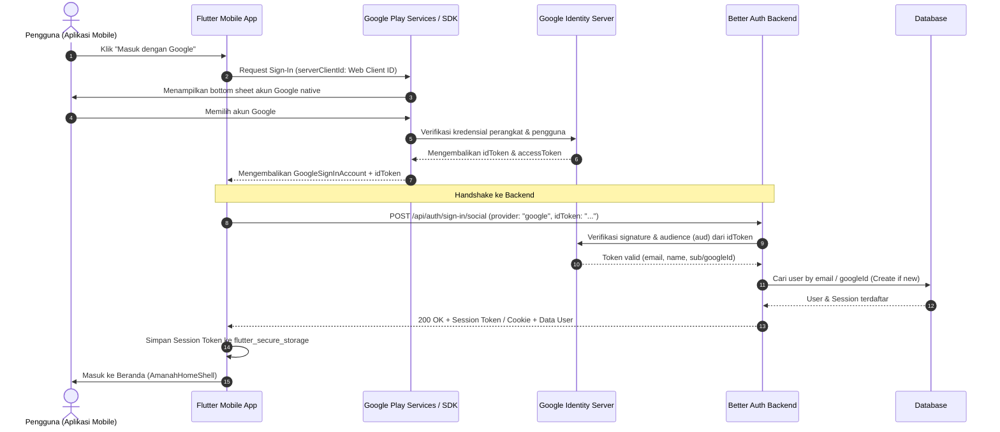

# Panduan Integrasi Google OAuth: Flutter Mobile ke Better Auth Backend
**Dokumen Spesifikasi & Handshake Teknis Frontend-to-Backend**

- **Versi Dokumen:** 1.0.0
- **Tanggal:** 2026-09-20
- **Penyusun:** Frontend Engineering (Mobile Team)
- **Target Pembaca:** Tim Backend (Implementer Better Auth) & Tim Mobile (Flutter)
- **Lokasi Dokumen:** `docs/requirements/better-auth-mobile-oauth-guide.md`
- **Status:** Panduan Resmi / Pre-Implementation Alignment

---

## 1. Latar Belakang & Tujuan

Dokumen ini dibuat untuk menyamakan persepsi antara **Tim Mobile (Flutter)** dan **Tim Backend (Better Auth)** terkait alur autentikasi Google OAuth pada aplikasi Android dan iOS.

Sering kali terjadi kesalahan fatal (misalignment) di mana tim backend mengira mobile menggunakan alur *Web Redirect URL* (seperti di browser). Padahal, di aplikasi mobile native (Flutter), Google melarang alur WebView redirect dan mewajibkan penggunaan **Google Sign-In Native SDK**.

Dokumen ini menjelaskan:
1. Cara kerja OAuth Mobile ke Backend Better Auth.
2. Kenapa ada **dua jenis Client ID** (Android Client ID & Web Client ID).
3. Yang harus disiapkan oleh Tim Backend di server Better Auth.
4. Yang harus disiapkan oleh Tim Mobile di Flutter.
5. Daftar kesalahan umum (*common pitfalls*) dan cara menghindarinya.

---

## 2. Diagram Alur Kerja (Architecture & Flow)

Alur autentikasi mobile **TIDAK menggunakan redirect browser**, melainkan verifikasi **`idToken`**:



---

## 3. Arsitektur Kredensial Google Cloud Console

Untuk mengintegrasikan Google Sign-In mobile ke Backend, diperlukan **2 jenis OAuth Client ID** di satu Google Cloud Project yang sama (`klinik-amanah-healthcare`):

### 3.1. Kredensial 1: Android OAuth Client ID (Dikelola Tim Mobile)
- **Tipe:** `Android`
- **Package Name:** `com.amanah.healthcare`
- **SHA-1 Fingerprint (Debug):** `7C:D7:95:43:8C:B6:F7:F0:72:DE:95:5F:89:E3:F6:99:6A:B5:F5:F3`
- **Client ID Android:** `649477011186-akbd11b8rgbbs8ipot3cf27alle6ac8v.apps.googleusercontent.com`
- **Fungsi:** Mengotorisasi aplikasi Android di HP pengguna agar diizinkan memanggil popup native Google Play Services.
- **Apakah Backend butuh ini?** Backend **TIDAK butuh file JSON-nya**, tetapi backend **bisa menambahkan ID ini ke daftar *authorized audiences*** jika diperlukan.

### 3.2. Kredensial 2: Web Application Client ID (Dikelola Tim Backend)
- **Tipe:** `Web application`
- **Nama:** `Amanah Healthcare Web / Backend`
- **Isi:**
  - `Client ID (Web)` (contoh: `649477011186-xxxxxxxx.apps.googleusercontent.com`)
  - `Client Secret (Web)` (contoh: `GOCSPX-xxxxxxxx`)
- **Fungsi:** 
  1. Backend Better Auth menggunakan kredensial ini untuk memvalidasi bahwa `idToken` memang ditujukan untuk sistem backend Amanah Healthcare.
  2. Mobile Flutter memasukkan `Client ID (Web)` ini ke parameter `serverClientId`. Dengan ini, Google akan membuatkan `idToken` yang ditujukan khusus untuk backend.

---

## 4. Tugas & Kebutuhan Tim Backend (Better Auth)

Tim Backend bertanggung jawab mengonfigurasi Better Auth agar menerima token dari mobile:

### 4.1. Konfigurasi Google Provider di Better Auth
Di file konfigurasi Better Auth (misal `auth.ts`):

```typescript
import { betterAuth } from "better-auth";

export const auth = betterAuth({
  database: // konfigurasi database Anda (Prisma/Drizzle/Kysely/dll),
  socialProviders: {
    google: {
      clientId: process.env.GOOGLE_WEB_CLIENT_ID!,
      clientSecret: process.env.GOOGLE_WEB_CLIENT_SECRET!,
      // Pastikan backend mengizinkan audience dari Web Client ID
    },
  },
  // Jika mobile mengirim idToken secara langsung:
  // Pastikan plugin social atau endpoint verifikasi idToken diaktifkan
});
```

### 4.2. Endpoint yang Disediakan untuk Mobile
Backend harus menyediakan salah satu dari dua pendekatan standar Better Auth:

#### Pendekatan Standar: Endpoint Social Sign-In dengan `idToken`
- **Method:** `POST`
- **URL:** `/api/auth/sign-in/social` (atau `/api/auth/sign-in/google/id-token` sesuai plugin Better Auth)
- **Headers:** `Content-Type: application/json`
- **Request Body:**
  ```json
  {
    "provider": "google",
    "idToken": "eyJhbGciOiJSUzI1NiIsImtpZCI..."
  }
  ```
- **Response Sukses (200 OK):**
  ```json
  {
    "session": {
      "token": "amanah_sess_token_abc123...",
      "expiresAt": "2026-10-20T12:00:00.000Z"
    },
    "user": {
      "id": "usr-12345",
      "name": "dr. Rayhan Pratama",
      "email": "dokter@amanah.health",
      "image": "https://lh3.googleusercontent.com/...",
      "role": "doctor",
      "isEmailVerified": true
    }
  }
  ```
- **Response Gagal (401 Unauthorized):**
  ```json
  {
    "code": "INVALID_TOKEN",
    "message": "Token Google tidak valid atau sudah kedaluwarsa."
  }
  ```

### 4.3. Pemetaan Peran (Role Mapping) Pengguna Baru
Jika user login pertama kali menggunakan Google dan belum ada di database:
- Tentukan aturan: Apakah default akun adalah `doctor` atau `staff`?
- Rekomendasi: User baru yang login via Google diberi status role pending / default `doctor`, atau backend mengecek apakah email terdaftar di database pegawai RS.

---

## 5. Tugas & Kebutuhan Tim Mobile (Flutter)

Tim Mobile bertanggung jawab mengimplementasikan Google Sign-In SDK di Flutter:

### 5.1. Dependensi yang Digunakan
```yaml
dependencies:
  google_sign_in: ^6.2.1
  flutter_secure_storage: ^9.2.2
```

### 5.2. Implementasi Sign-In di Flutter
Saat inisialisasi, tim mobile **wajib memasukkan `serverClientId`** (yaitu Web Client ID dari Backend):

```dart
final GoogleSignIn _googleSignIn = GoogleSignIn(
  // PENTING: serverClientId diisi Web Client ID dari backend
  serverClientId: dotenv.env['GOOGLE_OAUTH_CLIENT_ID_WEB'],
  scopes: <String>['email', 'profile'],
);

Future<void> handleGoogleSignIn() async {
  try {
    final GoogleSignInAccount? account = await _googleSignIn.signIn();
    if (account == null) {
      // User membatalkan login
      return;
    }

    final GoogleSignInAuthentication auth = await account.authentication;
    final String? idToken = auth.idToken;

    if (idToken == null) {
      throw Exception('Gagal mendapatkan idToken dari Google.');
    }

    // Kirim idToken ke backend Better Auth
    final response = await http.post(
      Uri.parse('$baseUrl/api/auth/sign-in/social'),
      headers: {'Content-Type': 'application/json'},
      body: jsonEncode({
        'provider': 'google',
        'idToken': idToken,
      }),
    );

    if (response.statusCode == 200) {
      // Simpan session token ke secure storage
      final data = jsonDecode(response.body);
      await secureStorage.write(key: 'session_token', value: data['session']['token']);
      // Navigasi ke halaman utama
    } else {
      // Tampilkan error
    }
  } catch (error) {
    // Tangani error
  }
}
```

---

## 6. Daftar Kesalahan Umum (Pitfalls) & Cara Mengatasinya

| No | Potensi Masalah / Kesalahan | Penyebab | Solusi |
| :--- | :--- | :--- | :--- |
| **1** | **Error `idToken == null` di Flutter** | Flutter tidak menyertakan `serverClientId` saat inisialisasi `GoogleSignIn()`. | Masukkan **Web Client ID** dari Google Cloud Console ke parameter `serverClientId`. |
| **2** | **Error `invalid_audience` di Backend** | Backend memverifikasi token terhadap Web Client ID, tetapi Google meng-generate token untuk Android Client ID (karena `serverClientId` kosong). | Pastikan `serverClientId` diisi di Flutter dan cocok dengan `GOOGLE_WEB_CLIENT_ID` di backend. |
| **3** | **Berhasil di Debug, tapi Gagal saat APK Release** | SHA-1 yang didaftarkan di Google Cloud Console hanya SHA-1 Debug laptop developer. | Daftarkan SHA-1 dari Release Keystore dan SHA-1 dari Google Play Console (App Signing) ke Google Cloud Console. |
| **4** | **Memaksa pakai WebView Redirect di Mobile** | Developer mencoba membuka URL OAuth login browser di dalam InAppWebView. | Google akan memblokir dengan error `disallowed_useragent`. Selalu gunakan SDK native `google_sign_in`. |
| **5** | **Session Cookie Hilang di Mobile** | Backend mengandalkan cookie `HttpOnly` tanpa konfigurasi Cookie Jar di client Flutter (Dio/Http). | Sebaiknya backend mengembalikan **Bearer Token** di JSON body untuk mobile, atau client Flutter menggunakan `dio_cookie_manager`. |

---

## 7. Checklist Koordinasi (Handshake Checklist)

### Checklist untuk Tim Backend:
- [ ] Buat **OAuth Client ID bertipe "Web application"** di Google Cloud Console project `klinik-amanah-healthcare`.
- [ ] Simpan `GOOGLE_WEB_CLIENT_ID` dan `GOOGLE_WEB_CLIENT_SECRET` di `.env` server backend.
- [ ] Bagikan string **`GOOGLE_WEB_CLIENT_ID`** ke Tim Mobile (Client Secret **JANGAN** dibagikan).
- [ ] Sediakan endpoint verifikasi `idToken` di Better Auth (`POST /api/auth/sign-in/social`).
- [ ] Pastikan respons mengembalikan Session Token dan data user (nama, email, role).

### Checklist untuk Tim Mobile:
- [ ] Simpan `GOOGLE_WEB_CLIENT_ID` dari backend ke file `.env` mobile (`GOOGLE_OAUTH_CLIENT_ID_WEB`).
- [ ] Pasang package `google_sign_in` dan `flutter_secure_storage`.
- [ ] Inisialisasi `GoogleSignIn` dengan `serverClientId: GOOGLE_OAUTH_CLIENT_ID_WEB`.
- [ ] Kirim `idToken` ke endpoint backend Better Auth.
- [ ] Simpan session token yang diterima ke `flutter_secure_storage`.
