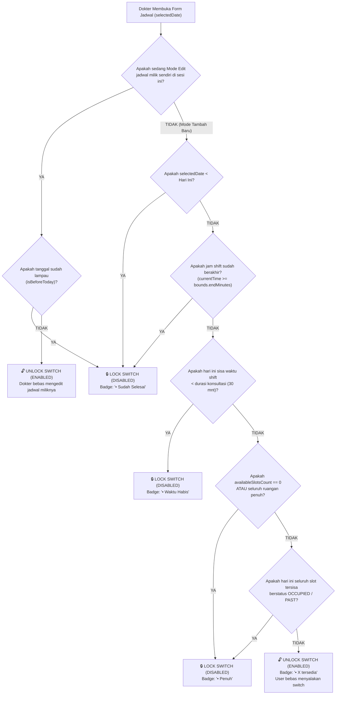

# Frontend Admin Web Delegation & UX Standardization Specification
**Target Audience:** Frontend Web-Admin Engineers (Next.js / React)  
**Author:** Mobile & Core Engineering Team (Amanah Healthcare)  
**Status:** Canonical Reference & Integration Guide  
**Paradigm:** Zero-Client-Calculation, Backend Delegation (Trust Backend), Dual-Axis Parent Guard Observer

---

> [!CAUTION]
> ### PERINGATAN ARSITEKTUR KRITIS UNTUK TIM WEB-ADMIN (NEXT.JS)
> **Pengecekan Waktu Saja (`now < shiftEndTime`) Adalah Salah & Menyebabkan Dead-End UX!**
> 
> Saat ini Web-Admin hanya mengecek apakah jam saat ini masih berada di dalam rentang shift (contoh: pukul 22:00 masih di dalam Sesi Malam `18:00 - 24:00 WIB`). Akibatnya, Web-Admin **tetap membiarkan switch sesi menyala (aktif)**, padahal:
> 1. Semua ruangan praktik pada shift tersebut **sudah penuh terisi oleh dokter lain**, ATAU
> 2. Semua slot jam yang tersisa dari jam 22:00 hingga 24:00 **berstatus `OCCUPIED_BY_OTHER` (Terisi)**.
> 
> Mengizinkan pengguna menyalakan switch sesi saat **tidak ada satu pun slot atau ruangan yang bisa dipilih** adalah **jebakan interaksi (Dead-End)**. Pengguna menyalakan switch, masuk ke dalam form, mendapati semua ruangan/jam terkunci, lalu frustrasi karena tombol simpan gagal atau error 409.
> 
> **Mulai versi ini, Parent Toggle Switch wajib diobservasi secara DUAL-AXIS (Sumbu Waktu + Sumbu Okupansi Ruangan/Slot).** Jika kuota habis atau seluruh ruangan penuh, **SWITCH HARUS LANGSUNG TERKUNCI MATI (DISABLED)** dari luar.

---

## 1. Studi Kasus Nyata: Mengapa Sesi Malam Terkunci di Flutter?

Mari ambil contoh kasus nyata yang terjadi hari ini pada pukul **22:36 WIB**:
- **Sesi**: Malam (`18:00 - 24:00 WIB`).
- **Waktu Jam Server**: 22:36 WIB (secara jam dinding, shift malam *belum* selesai karena batasnya 24:00 WIB).

### Mengapa di Web-Admin Error, Tetapi di Flutter Terkunci Rapi?

```
┌─────────────────────────────────────────────────────────────────────────────┐
│ ALUR KEPUTUSAN WEB-ADMIN (LOGIKA LAMA / KELIRU):                            │
│ Apakah jam 22:36 < 24:00? -> YA -> SWITCH TETAP BISA DI-KLIK (ON)           │
│ User klik ON -> Form terbuka -> Pilih Jam: SEMUA PENUH -> Submit: ERROR 409 │
│ HASIL: DEAD-END UX (Pengguna terjebak dan bingung)                          │
└─────────────────────────────────────────────────────────────────────────────┘

┌─────────────────────────────────────────────────────────────────────────────┐
│ ALUR KEPUTUSAN FLUTTER MOBILE (LOGIKA DUAL-AXIS / BENAR):                    │
│ 1. Cek Sumbu Waktu: Apakah shift sudah lewat? (Belum, 22:36 < 24:00)        │
│ 2. Cek Sisa Waktu: Apakah cukup 1 sesi? (24:00 - 22:36 = 84 menit, cukup)   │
│ 3. Cek Sumbu Ruangan/Okupansi:                                              │
│    - Apakah data occupancy menunjukkan availableSlotsCount == 0?            │
│    - Apakah semua slot di masa depan (22:30, 23:00, 23:30) sudah terisi?    │
│    -> YA! SEMUA RUANGAN & SLOT TERISI DOKTER LAIN.                          │
│ 4. KESIMPULAN: Tidak ada hal produktif yang bisa dilakukan dokter di sesi   │
│    ini.                                                                     │
│ HASIL: SWITCH LANGSUNG DI-LOCK (DISABLED) DENGAN BADGE "• Penuh"            │
└─────────────────────────────────────────────────────────────────────────────┘
```

---

## 2. Diagram Alir Observasi Parent Switch (Dual-Axis Guard)

Berikut adalah diagram pohon keputusan yang **wajib diterapkan di komponen Header Sesi Web-Admin**:



---

## 3. Matriks Lengkap Status Parent Switch

| No | Kondisi Real-Time | Status Switch Parent | Label / Badge Subtitle | Aksi User Jika Diklik |
| :-: | :--- | :---: | :---: | :--- |
| **1** | Tanggal sebelum hari ini (`selectedDate < today`) | **LOCKED (OFF)** | `• Sudah Selesai` | `onTap` dinonaktifkan (`cursor-not-allowed`) |
| **2** | Hari ini, jam akhir shift sudah lewat (`now >= shiftEnd`) | **LOCKED (OFF)** | `• Sudah Selesai` | `onTap` dinonaktifkan (`cursor-not-allowed`) |
| **3** | Hari ini, sisa waktu shift < durasi pasien (misal sisa 20 mnt, durasi butuh 30 mnt) | **LOCKED (OFF)** | `• Waktu Habis` | `onTap` dinonaktifkan (`cursor-not-allowed`) |
| **4** | **Shift masih ada waktu, tetapi semua ruangan penuh** (`availableSlotsCount == 0`) | **LOCKED (OFF)** | `• Penuh` | `onTap` dinonaktifkan (`cursor-not-allowed`) |
| **5** | **Shift masih ada waktu, tetapi seluruh slot masa depan sudah terisi dokter lain** | **LOCKED (OFF)** | `• Penuh` | `onTap` dinonaktifkan (`cursor-not-allowed`) |
| **6** | Shift masih memiliki minimal 1 slot dan ruangan yang kosong | **ENABLED** | `• X tersedia` | Bebas di-toggle ON/OFF oleh pengguna |
| **7** | **Pengecualian: Mode Edit Jadwal Sendiri** | **ENABLED** | Sesuai Data | Tetap aktif agar dokter dapat mengubah ruangan/slot miliknya |

---

## 4. Mekanisme Multi-Slot: Tombol "+ Add More"

Di dalam setiap sesi yang berhasil dinyalakan (Switch ON), dokter dapat memiliki beberapa kelompok antrean:
1. **Slot Pertama (Default)**:
   - Begitu switch dinyalakan, buat 1 slot baris secara otomatis.
   - Ruangan default dan Poli default diambil langsung dari `doctor.defaultRoomName` dan `doctor.defaultPoliklinikName` dari endpoint `form-bootstrap`. **Dilarang keras memakai fallback asal-asalan seperti `rooms[0]`**.
2. **Tombol "+ Add More"**:
   - Berada di bawah daftar slot pada sesi tersebut.
   - **Aturan Validasi Sebelum Slot Baru Ditambahkan**:
     - Slot sebelumnya tidak boleh kosong jam mulainya (`from != ''` dan `from != 'Pilih Jam'`).
     - Hitung: `jamSelesaiSlotTerakhir + durasiKonsultasi`. Jika hasil penjumlahan melebihi `shiftBoundary.endMinutes`, tombol "+ Add More" harus memunculkan pesan peringatan:
       > *"Sesi sudah terisi hingga batas shift (XX:XX WIB). Setiap antrean membutuhkan minimal 30 menit."*

---

## 5. Mengatasi Masalah Stale Cache Pada Next.js (App Router / Pages Router)

Penyebab web admin sering ketinggalan data (stale) sehingga status shift tidak sinkron:
1. **Jangan Simpan Status Okupansi di Local Component State**:
   - Jika admin mengganti tanggal di datepicker, state slot dan ruangan tidak boleh mengandalkan state lama.
2. **Revalidasi Wajib (Trigger Matrix)**:
   - **Trigger 1 (Ganti Tanggal)**:
     Fetch ulang `GET /api/v1/schedules/form-bootstrap?date=YYYY-MM-DD` dan `GET /api/v1/schedules/occupancy-overview?date=YYYY-MM-DD`.
   - **Trigger 2 (Ganti Ruangan di salah satu baris)**:
     Fetch ulang `GET /api/v1/schedules/slot-availability?date=YYYY-MM-DD&shift=:shift&roomId=:roomId`.
   - **Trigger 3 (Setelah Simpan / Hapus Jadwal Berhasil)**:
     Lakukan invalidasi query cache:
     ```typescript
     queryClient.invalidateQueries({ queryKey: ['schedules'] });
     queryClient.invalidateQueries({ queryKey: ['occupancy-overview'] });
     queryClient.invalidateQueries({ queryKey: ['slot-availability'] });
     ```

---

## 6. Spesifikasi Endpoint Backend & Kontrak Response

### 1. Form Bootstrap (`GET /api/v1/schedules/form-bootstrap`)
Digunakan saat modal form pertama kali dibuka atau saat ganti tanggal.

- **Query Parameters**:
  - `date`: `YYYY-MM-DD` (Wajib)
  - `scheduleId`: `UUID` (Opsional, untuk mode edit)

```json
{
  "date": "2026-09-25",
  "doctor": {
    "id": "doc-uuid-001",
    "name": "drg. Sarah Jenkins, Sp.KG",
    "defaultRoomId": "room-uuid-01",
    "defaultRoomName": "Ruang Poli Gigi 1",
    "defaultPoliklinikId": "poli-uuid-01",
    "defaultPoliklinikName": "Poli Gigi & Mulut",
    "consultationDurationMinutes": 30
  },
  "rooms": [
    {
      "id": "room-uuid-01",
      "name": "Ruang Poli Gigi 1",
      "isOccupied": false
    },
    {
      "id": "room-uuid-02",
      "name": "Ruang Poli Gigi 2",
      "isOccupied": true
    }
  ],
  "polikliniks": [
    {
      "id": "poli-uuid-01",
      "name": "Poli Gigi & Mulut"
    }
  ],
  "shifts": [
    {
      "id": "pagi",
      "code": "PAGI",
      "name": "Sesi Pagi",
      "startTime": "08:00",
      "endTime": "11:30",
      "isPast": true,
      "existingSchedule": null
    },
    {
      "id": "malam",
      "code": "MALAM",
      "name": "Sesi Malam",
      "startTime": "18:00",
      "endTime": "24:00",
      "isPast": false,
      "existingSchedule": null
    }
  ]
}
```

---

### 2. Occupancy Overview (`GET /api/v1/schedules/occupancy-overview`)
**Kunci observasi Parent Switch.** Memberikan data rekapitulasi apakah shift penuh di seluruh ruangan.

- **Query Parameters**:
  - `date`: `YYYY-MM-DD` (Wajib)
  - `roomId`: `UUID` (Opsional)

```json
{
  "date": "2026-09-25",
  "roomId": "room-uuid-01",
  "summary": {
    "totalShifts": 4,
    "totalSlots": 48,
    "availableSlots": 0,
    "occupiedSlots": 48
  },
  "shifts": [
    {
      "shift": "malam",
      "shiftLabel": "Malam",
      "timeRange": "18:00 - 24:00 WIB",
      "boundaryStartTime": "18:00",
      "boundaryEndTime": "24:00",
      "slotDurationMinutes": 30,
      "totalSlots": 12,
      "availableSlotsCount": 0,
      "occupiedSlotsCount": 12,
      "slots": [
        {
          "slotIndex": 0,
          "startTime": "18:00",
          "endTime": "18:30",
          "isAvailable": false,
          "status": "OCCUPIED_BY_OTHER",
          "displayLabel": "18:00 - 18:30 (Terisi)",
          "conflictInfo": {
            "type": "ROOM_OCCUPIED",
            "message": "Ruangan telah digunakan oleh dr. Budi Santoso",
            "practitionerName": "dr. Budi Santoso"
          }
        }
      ]
    }
  ]
}
```

---

### 3. Slot Availability Matrix (`GET /api/v1/schedules/slot-availability`)
Dipanggil saat dropdown jam mulai pada baris slot diklik. **Web-admin dilarang menghitung bentrok jam secara manual di frontend.** Cukup render opsi berdasarkan respon ini.

- **Query Parameters**:
  - `date`: `YYYY-MM-DD` (Wajib)
  - `shift`: `pagi` | `siang` | `malam` | `dini_hari` (Wajib)
  - `roomId`: `UUID` (Wajib)
  - `scheduleId`: `UUID` (Opsional, sertakan saat edit)

```json
{
  "date": "2026-09-25",
  "shift": "malam",
  "roomId": "room-uuid-01",
  "roomName": "Ruang Poli Gigi 1",
  "summary": {
    "totalSlots": 12,
    "availableSlots": 0,
    "occupiedSlots": 12
  },
  "slots": [
    {
      "slotIndex": 0,
      "time": "18:00",
      "endTime": "18:30",
      "status": "PAST",
      "isAvailable": false,
      "displayLabel": "18:00 - 18:30 (Sudah Selesai)",
      "conflict": {
        "type": "SHIFT_PAST",
        "reason": "Jam praktik telah terlewati"
      }
    },
    {
      "slotIndex": 8,
      "time": "22:00",
      "endTime": "22:30",
      "status": "OCCUPIED_BY_OTHER",
      "isAvailable": false,
      "displayLabel": "22:00 - 22:30 (Terisi)",
      "conflict": {
        "type": "ROOM_OCCUPIED",
        "occupantName": "drg. Anton Wijaya, Sp.Pros",
        "reason": "Ruangan telah digunakan oleh drg. Anton Wijaya, Sp.Pros"
      }
    }
  ]
}
```

---

## 7. Kode Referensi TypeScript Siap Pakai untuk Next.js

Salin kode fungsi guard berikut langsung ke proyek Next.js Anda:

```typescript
// lib/schedule-guard.ts

export interface ShiftBoundary {
  startMinutes: number;
  endMinutes: number;
  defaultStart: string;
  defaultEnd: string;
}

export function parseTimeToMinutes(timeStr: string): number | null {
  if (!timeStr) return null;
  const clean = timeStr.replace(/WIB|AM|PM/gi, '').trim();
  const [h, m] = clean.split(':').map(Number);
  if (isNaN(h) || isNaN(m)) return null;
  return h * 60 + m;
}

export function checkSessionAvailability({
  sessionId,
  selectedDate,
  isPastFromBackend,
  occupancy,
  bounds,
  consultationDuration = 30,
  isEditingThisSession = false,
}: {
  sessionId: string;
  selectedDate: Date;
  isPastFromBackend?: boolean;
  occupancy?: {
    totalSlots: number;
    availableSlotsCount: number;
    slots?: Array<{ startTime: string; isAvailable: boolean }>;
  };
  bounds: ShiftBoundary;
  consultationDuration?: number;
  isEditingThisSession?: boolean;
}): { isDisabled: boolean; badgeLabel: string | null } {
  // Jika sedang mengedit jadwal milik sendiri, biarkan terbuka kecuali tanggal sudah lewat
  if (isEditingThisSession) {
    return { isDisabled: false, badgeLabel: null };
  }

  const now = new Date();
  const isToday =
    selectedDate.getFullYear() === now.getFullYear() &&
    selectedDate.getMonth() === now.getMonth() &&
    selectedDate.getDate() === now.getDate();

  const isPastDate =
    selectedDate < new Date(now.getFullYear(), now.getMonth(), now.getDate());

  // 1. Shift sudah lewat secara tanggal atau dinyatakan lampau oleh backend
  if (isPastDate || isPastFromBackend) {
    return { isDisabled: true, badgeLabel: 'Sudah Selesai' };
  }

  // 2. Kuota shift terisi penuh di semua ruangan (availableSlotsCount == 0)
  if (occupancy && occupancy.totalSlots > 0 && occupancy.availableSlotsCount === 0) {
    return { isDisabled: true, badgeLabel: 'Penuh' };
  }

  // 3. Evaluasi hari ini (waktu berjalan)
  if (isToday) {
    const currentMinutes = now.getHours() * 60 + now.getMinutes();

    // Batas jam shift sudah selesai hari ini
    if (currentMinutes >= bounds.endMinutes) {
      return { isDisabled: true, badgeLabel: 'Sudah Selesai' };
    }

    // Sisa waktu shift kurang dari durasi minimal periksa (misal sisa 20 mnt, butuh 30 mnt)
    if (bounds.endMinutes - currentMinutes < consultationDuration) {
      return { isDisabled: true, badgeLabel: 'Waktu Habis' };
    }

    // Jika ada daftar slot okupansi hari ini, pastikan masih ada slot masa depan yang available
    if (occupancy?.slots && occupancy.slots.length > 0) {
      const hasFutureAvailableSlot = occupancy.slots.some((slot) => {
        const slotStartM = parseTimeToMinutes(slot.startTime);
        return slotStartM !== null && slotStartM >= currentMinutes && slot.isAvailable;
      });

      if (!hasFutureAvailableSlot) {
        return { isDisabled: true, badgeLabel: 'Penuh' };
      }
    }
  }

  return { isDisabled: false, badgeLabel: null };
}
```

### Implementasi Komponen Switch di Next.js:
```tsx
// components/schedule/SessionHeader.tsx
import React from 'react';
import { Switch } from '@/components/ui/switch';
import { checkSessionAvailability } from '@/lib/schedule-guard';

export const SessionHeader = ({
  session,
  selectedDate,
  bootstrapShift,
  occupancy,
  bounds,
  isEditingThisSession,
  onToggle,
}: any) => {
  const { isDisabled, badgeLabel } = checkSessionAvailability({
    sessionId: session.id,
    selectedDate,
    isPastFromBackend: bootstrapShift?.isPast,
    occupancy,
    bounds,
    isEditingThisSession,
  });

  const isActive = !isDisabled && session.active;

  return (
    <div className={`flex items-center justify-between p-4 border rounded-xl ${isDisabled ? 'bg-slate-50 opacity-60 cursor-not-allowed' : 'bg-white'}`}>
      <div>
        <h4 className="text-sm font-bold text-slate-800">{session.name}</h4>
        <p className="text-xs text-slate-500">
          {bounds.defaultStart} - {bounds.defaultEnd} WIB
          {badgeLabel ? (
            <span className="ml-2 font-semibold text-rose-600">• {badgeLabel}</span>
          ) : occupancy?.availableSlotsCount > 0 ? (
            <span className="ml-2 font-semibold text-emerald-600">• {occupancy.availableSlotsCount} tersedia</span>
          ) : null}
        </p>
      </div>

      {/* Switch terkunci jika disabled */}
      <Switch
        checked={isActive}
        disabled={isDisabled}
        onCheckedChange={(checked) => {
          if (!isDisabled) {
            onToggle(checked);
          }
        }}
      />
    </div>
  );
};
```
